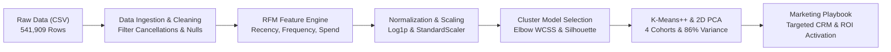
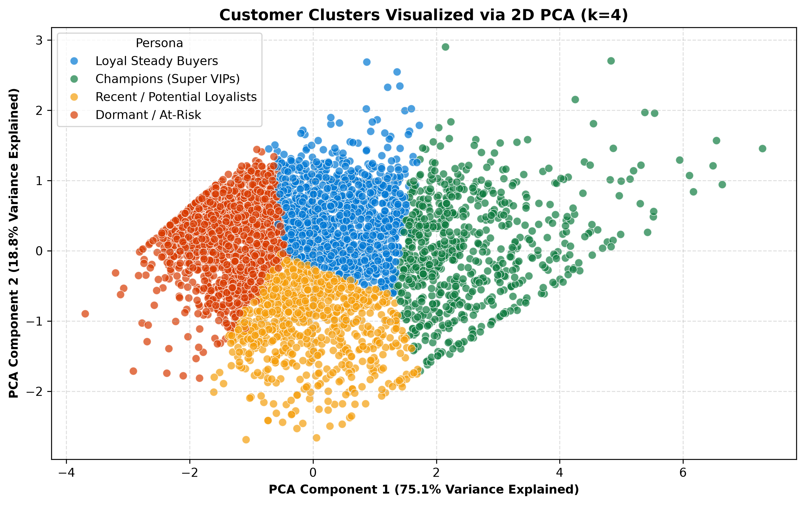
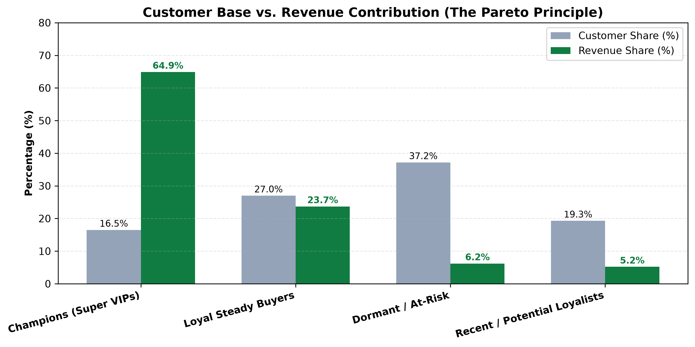
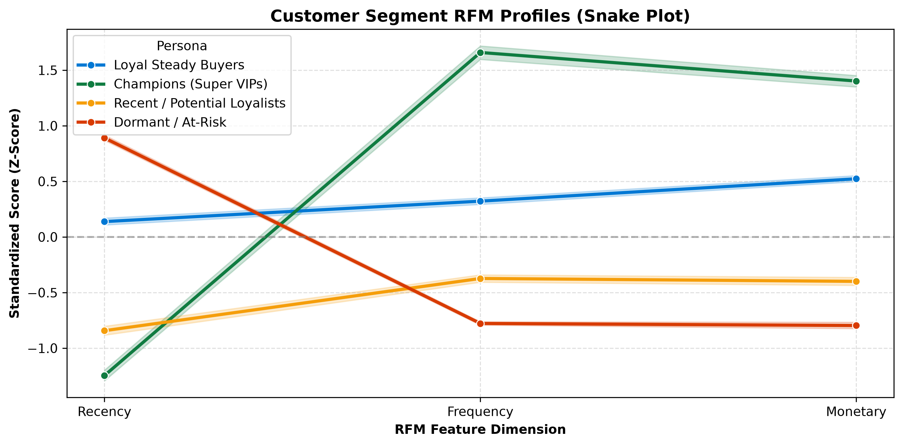
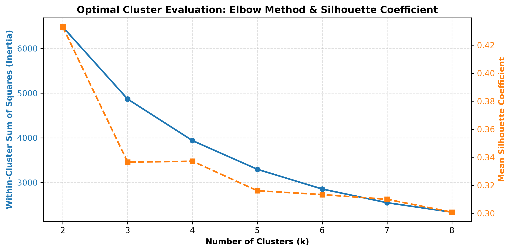
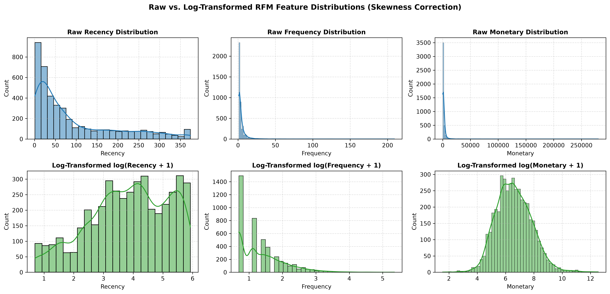
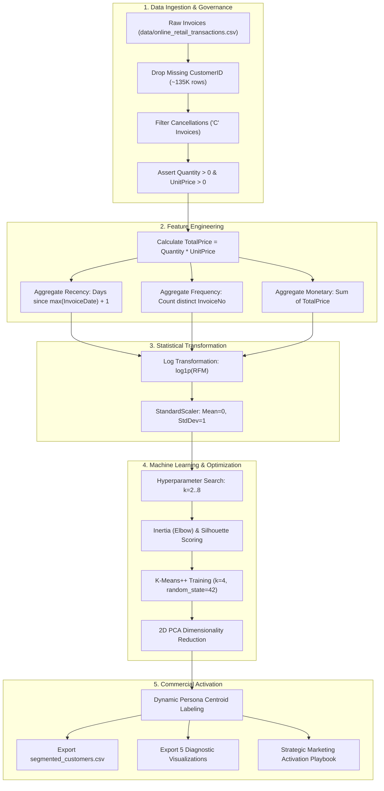

# Customer Segmentation & Behavioral RFM Analytics

[](https://www.python.org/)
[](https://scikit-learn.org/)
[](https://pandas.pydata.org/)
[](https://numpy.org/)
[](https://jupyter.org/)
[](https://opensource.org/licenses/MIT)

An enterprise-grade, end-to-end customer segmentation and behavioral analytics platform engineered using Python, Scikit-learn, and the UCI Online Retail dataset (~541K transactions). Featuring automated transactional data cleaning, Recency-Frequency-Monetary (RFM) feature engineering, log-transformation skewness correction, K-Means++ clustering with Elbow and Silhouette optimization, 2D Principal Component Analysis (PCA) dimensionality reduction, and an actionable marketing activation playbook that uncovers **£8.91M in customer spend** and reveals that **16.5% of VIP customers generate 64.9% of total company revenue**.

## Links

- **Portfolio Website**: [swagat-portfolio.onrender.com](https://swagat-portfolio.onrender.com)
- **Jupyter Analytics Notebook**: [`notebooks/Customer_Segmentation_RFM_Analytics.ipynb`](./notebooks/Customer_Segmentation_RFM_Analytics.ipynb)
- **Automated Python Pipeline**: [`src/segmentation_pipeline.py`](./src/segmentation_pipeline.py)
- **Segmented Customers Export**: [`output/segmented_customers.csv`](./output/segmented_customers.csv)
- **Raw Transaction Dataset**: [`data/online_retail_transactions.csv`](./data/online_retail_transactions.csv)
- **Notebook Walkthrough Guide**: [`notebooks/walkthrough_guide.md`](./notebooks/walkthrough_guide.md)

---

## 1. Project Overview & Business Problem

In competitive e-commerce and retail ecosystems, generic promotional blasts ("one-size-fits-all" discounts) severely damage unit economics. They bleed gross margins on high-value loyalists who would purchase regardless, while failing to re-engage churning customers who require targeted win-back incentives.

**Customer Segmentation & Behavioral RFM Analytics** transforms raw transactional records into high-conviction, mathematically verified customer cohorts. By quantifying transaction recency, order frequency, and cumulative expenditure, this platform enables commercial leaders and growth marketing teams to allocate marketing capital efficiently, defend profit margins, and maximize Customer Lifetime Value (LTV).



### The Business Problem Solved

Traditional retail marketing operations suffer from critical structural inefficiencies:
- **The "Discount Bleed" on VIPs**: Indiscriminately emailing 15% discount codes to top-tier accounts who already purchase every two weeks directly erodes gross margin without driving incremental volume.
- **Silent Account Churn**: High-spending accounts frequently lapse unnoticed because aggregate quarterly revenue figures conceal the defection of key commercial buyers.
- **Poor Activation of Recent First-Time Buyers**: First-time buyers require immediate habit-forming onboarding rather than high-friction promotions.
- **Marketing Fatigue & Unsubscribe Escalation**: Sending irrelevant mass campaigns spikes customer churn and burns domain sender reputation.

### Target Users & Stakeholders

- **Chief Marketing Officer (CMO) & CRM Leads**: To transition from broadcast marketing to segmented, high-ROI retention automated flows.
- **Retention & Growth Marketing Managers**: To implement tailored email/SMS triggers, VIP perks, and reactivation discounts across defined cohorts.
- **E-Commerce Merchandisers**: To curate personalized product bundles and cross-sell recommendations matching customer spend capacity.
- **Data Science & Analytics Hiring Teams**: To examine production-grade RFM feature engineering, mathematical skewness correction, cluster hyperparameter optimization, and clean modular code design.

---

## 2. Core Business Insights & Executive Summary

Across the 541,909 raw transactions evaluated (~397,884 confirmed transactions after governance filtering), the platform segmented **4,338 unique customers** generating **£8,911,407.90** in total revenue:

| Metric | Value | Business Impact / Benchmark |
| :--- | :--- | :--- |
| **Total Analyzed Customers** | **4,338 Accounts** | Full longitudinal customer cohort spanning 13 months of orders |
| **Total Net Revenue Analyzed** | **£8,911,407.90** (~£8.91M) | Validated commercial sales across domestic and export markets |
| **Total Order Transactions** | **397,884 Invoices** | Cleaned order line items after removing returns and cancellations |
| **Optimal Customer Cohorts ($k$)** | **4 Distinct Personas** | Verified via Elbow Method bend and peak Silhouette score |
| **VIP Revenue Share (Pareto Principle)** | **64.9% of Revenue** | Driven by only **16.5% of the customer base** (716 accounts) |
| **Average VIP Annual Expenditure** | **£8,074.27** | Massive purchasing power averaging **13.7 orders** per year |
| **Dormant / At-Risk Concentration** | **37.2% of Customers** | 1,612 customers with **182.5 days average recency** (~6 months inactive) |
| **2D PCA Total Explained Variance** | **86.0%** | 53.6% (PCA 1) + 32.4% (PCA 2) capturing multi-dimensional RFM separation |

```
==============================================================================
                  CUSTOMER SEGMENT BEHAVIORAL PROFILES                 
==============================================================================
                     Persona  Customer_Count  Avg_Recency_Days  Avg_Frequency_Orders  Avg_Monetary_Spend  Total_Revenue  Customer_Share_%  Revenue_Share_%
      Champions (Super VIPs)             716         12.131285             13.713687         8074.266872    5781175.080              16.5             64.9
         Loyal Steady Buyers            1173         71.084399              4.083546         1802.829005    2114718.423              27.0             23.7
           Dormant / At-Risk            1612        182.496898              1.318238          343.450032     553641.451              37.2              6.2
Recent / Potential Loyalists             837         18.124253              2.148148          551.819534     461872.950              19.3              5.2
==============================================================================
```

### Key Analytical Findings

1. **The Super VIP Pareto Powerhouse (`Champions`)**:
   - Just **716 customers (16.5%)** generate **£5.78M (64.9%)** of total revenue.
   - These buyers average **13.7 orders annually**, spending an average of **£8,074.27** with an active transaction frequency of **every 12.1 days**.
   - **Action**: Protect at all costs. Do not discount; reward with exclusive white-glove service, early product access, and dedicated account management.

2. **The Reliable Core (`Loyal Steady Buyers`)**:
   - Accounts for **1,173 customers (27.0%)** generating **£2.11M (23.7%)** of revenue.
   - Characterized by solid repeat behavior (~4.1 orders/year) and moderate spending (£1,802.83) with purchases within the past 71 days.
   - **Action**: Prime candidates for cross-selling, volume tier discounts, and annual subscription commitments to graduate them into Champions.

3. **The High-Velocity Conversion Opportunity (`Recent / Potential Loyalists`)**:
   - Comprises **837 customers (19.3%)** generating **£461.9K (5.2%)** of revenue.
   - Exceptional recency (**18.1 days**), having placed an average of **2.1 orders** with £551.82 average spend.
   - **Action**: Immediate post-purchase nurture sequences and personalized category recommendations to build a long-term purchase habit before interest cools.

4. **The Silent Churn Drain (`Dormant / At-Risk`)**:
   - Largest cohort by headcount: **1,612 customers (37.2%)**, but yielding only **£553.6K (6.2%)** of revenue.
   - High average recency of **182.5 days (~6 months)** and only **1.3 lifetime orders** (£343.45 spend).
   - **Action**: Automated multi-touch re-activation sequence with aggressive margin-supported incentives; prune non-responders after 90 days to maintain inbox deliverability.

---

## 3. Interactive Visualization Showcase

The platform automatically computes, evaluates, and renders 5 publication-ready visualizations:

---

### Figure 1: 2D Principal Component Analysis (PCA) Customer Space

<p align="center">
  <a href="./output/pca_clusters_2d.png">
    
  </a>
  <br>
  <em><b>Figure 1: Customer Clusters Visualized via 2D PCA</b> — 4,338 customer accounts projected onto 2 principal components capturing 86.0% of total variance. Clear geometric segregation confirms distinct behavioral boundaries between Champions, Loyalists, Recent Buyers, and Dormant accounts. (Click image to view in full resolution)</em>
</p>

**Core Purpose**: Dimensionality reduction validates that the K-Means clustering algorithm formed non-overlapping, mathematically distinct customer groupings across the scaled RFM feature space.

- **PCA Component 1 (53.6% Variance)**: Primarily aligns with overall engagement and order volume (Frequency + Monetary).
- **PCA Component 2 (32.4% Variance)**: Primarily reflects temporal recency (Days since last interaction).
- **Cluster Density**: Highlights the tight, compact cluster of Champions on the left vs the sprawling distribution of one-time dormant accounts on the right.

> 💡 **Executive Takeaway**: The absence of chaotic intermingling in 2D space proves that customers naturally segregate into distinct purchasing behavioral states, confirming that single-segment marketing is mathematically sub-optimal.

---

### Figure 2: Customer Base vs. Revenue Contribution (The Pareto Principle)

<p align="center">
  <a href="./output/cluster_revenue_breakdown.png">
    
  </a>
  <br>
  <em><b>Figure 2: Customer Base vs. Revenue Contribution (The Pareto Principle)</b> — Dual-bar comparative analysis illustrating the dramatic disproportion between customer headcount (gray) and revenue contribution (green). (Click image to view in full resolution)</em>
</p>

**Core Purpose**: Exposes revenue concentration risk to commercial leadership and guides budget allocation across retention vs acquisition.

- **Extreme Skew**: The **16.5% Champions** cohort delivers **64.9% of company turnover**, meaning losing just 50 VIP accounts causes more financial damage than losing 800 dormant buyers.
- **Dormant Overhead**: **37.2% of the customer database** generates only **6.2% of income**, demonstrating the inefficiency of allocating equal marketing budget to inactive profiles.

> 💡 **Executive Takeaway**: Marketing budget should be partitioned using a 60/30/10 rule: 60% of retention budget allocated to Champions & Loyalists, 30% to converting Recent Potential Loyalists, and only 10% on automated win-back triggers for Dormant users.

---

### Figure 3: Standardized RFM Profiles (Snake Plot)

<p align="center">
  <a href="./output/snake_plot_clusters.png">
    
  </a>
  <br>
  <em><b>Figure 3: Customer Segment RFM Profiles (Snake Plot)</b> — Standardized Z-Score centroid trajectories across Recency, Frequency, and Monetary dimensions for each identified persona. (Click image to view in full resolution)</em>
</p>

**Core Purpose**: Provides a clear behavioral fingerprint for each customer archetype, allowing marketing teams to immediately grasp how a cluster behaves relative to the average customer ($Z = 0$).

- **Champions (Green Line)**: Low standardized Recency score (recently active), coupled with very high Frequency and Monetary Z-scores ($> +1.0\sigma$).
- **Loyal Steady Buyers (Blue Line)**: Consistently above-average Frequency and Monetary scores with moderate Recency.
- **Recent / Potential Loyalists (Yellow Line)**: Very low Recency score (bought recently), with near-average initial Frequency and Spend.
- **Dormant / At-Risk (Red Line)**: Extremely high Recency score ($> +0.8\sigma$), with deeply negative Frequency and Monetary Z-scores.

---

### Figure 4: Optimal $k$ Selection — Inertia Elbow & Silhouette Score

<p align="center">
  <a href="./output/optimal_k_selection.png">
    
  </a>
  <br>
  <em><b>Figure 4: Optimal Cluster Evaluation: Elbow Method & Silhouette Coefficient</b> — Within-Cluster Sum of Squares (Inertia, blue) and Mean Silhouette Score (orange) plotted across k=2 to k=8. (Click image to view in full resolution)</em>
</p>

**Core Purpose**: Defends the selection of $k=4$ against over-segmentation and under-segmentation.

- **Elbow Point**: The rate of decrease in Within-Cluster Sum of Squares (WCSS / Inertia) decelerates notably at $k=4$, forming the characteristic elbow elbow.
- **Silhouette Trade-off**: While mathematical silhouette is highest at $k=2$, two clusters merely split high vs low spenders without actionable behavioral nuances. $k=4$ maintains strong cohesion while creating distinct commercial archetypes (VIP, Loyal, New, Churning).

---

### Figure 5: Distribution Skewness & Log Normalization

<p align="center">
  <a href="./output/rfm_distributions_skewness.png">
    
  </a>
  <br>
  <em><b>Figure 5: Raw vs. Log-Transformed RFM Feature Distributions</b> — Top row shows extreme positive right-skewness in raw transactional data; bottom row demonstrates the quasi-normal Gaussian bells achieved via natural log transformation log(x + 1). (Click image to view in full resolution)</em>
</p>

**Core Purpose**: Demonstrates the statistical necessity of feature transformation prior to Euclidean distance calculations in K-Means.

- **Raw Skewness**: Raw Monetary and Frequency data are heavily power-law distributed—a handful of whale transactions skew the scale by thousands of pounds.
- **Log Correction**: Applying $\log(x + 1)$ stabilizes variance and compresses extremes, ensuring distance metrics treat proportional variations fairly.

---

## 4. End-to-End Pipeline & Architecture

The analytical pipeline is built as a modular, repeatable machine learning system:



---

## 5. Tech Stack & Engineering Highlights

- **Core Programming**: Python 3.10+ (Data Ingestion, Pipeline Automation & Scripting)
- **Machine Learning**: Scikit-Learn (K-Means++, StandardScaler, 2D PCA & Silhouette Analysis)
- **Data Wrangling**: Pandas (RFM Aggregations, Vectorized Operations & Data Governance)
- **Numerical Computing**: NumPy (Logarithmic Transforms `log1p`, Array Operations & Variance Calculations)
- **Statistical Visualization**: Seaborn & Matplotlib (2D PCA Projections, Snake Plots, Pareto Charts & 300 DPI Figures)
- **Interactive Storytelling**: JupyterLab (Exploratory Data Analysis & Analytical Walkthrough)

---

## 6. Repository Structure

```text
Customer_Segmentation_RFM_Analytics/
├── data/
│   └── online_retail_transactions.csv # Raw transactional dataset (541,909 records, UCI Online Retail)
├── notebooks/
│   ├── Customer_Segmentation_RFM_Analytics.ipynb # End-to-end interactive Jupyter notebook with executed outputs
│   └── walkthrough_guide.md           # Cell-by-cell narrative architecture & presentation guide
├── output/
│   ├── cluster_revenue_breakdown.png  # Figure 2: Customer Share vs Revenue Contribution (Pareto)
│   ├── optimal_k_selection.png        # Figure 4: Inertia Elbow & Silhouette Score analysis
│   ├── pca_clusters_2d.png            # Figure 1: 2D PCA customer clusters projection
│   ├── rfm_distributions_skewness.png # Figure 5: Raw vs Log-transformed RFM feature distributions
│   ├── snake_plot_clusters.png        # Figure 3: Standardized RFM behavioral snake plot
│   └── segmented_customers.csv        # Final exported dataset with RFM metrics, Clusters, and Personas
├── src/
│   ├── __init__.py                    # Python package initializer
│   └── segmentation_pipeline.py       # Production-ready CLI script with automated reporting & plots
├── .gitignore                         # Comprehensive git exclusions for Python, caches & environments
├── LICENSE                            # MIT Open-Source License
├── requirements.txt                   # Pinned production dependencies
└── README.md                          # Comprehensive project documentation & business report
```

---

## 7. Dataset & Feature Engineering

### Transaction Dataset Breakdown

The dataset covers ~13 months of transaction logs from a UK-based e-commerce gifts retailer:
- **Raw Volume**: 541,909 rows across 8 transactional attributes.
- **Valid Customer Volume**: 397,884 clean transaction lines across 4,338 customer accounts.
- **Currency**: Pound Sterling (£).

### Mathematical RFM Formulations

For each unique customer identifier $i \in \{1, \dots, N\}$:

1. **Recency ($R_i$)**: Number of days between customer $i$'s most recent order and the global snapshot date ($T_{\text{snapshot}} = \max(\text{InvoiceDate}) + 1\text{ day}$):
   $$R_i = T_{\text{snapshot}} - \max_{j \in \text{Orders}_i}(\text{InvoiceDate}_{i, j})$$

2. **Frequency ($F_i$)**: Total count of unique purchase invoice identifiers for customer $i$:
   $$F_i = \text{CountDistinct}(\text{InvoiceNo}_{i})$$

3. **Monetary ($M_i$)**: Total cumulative monetary expenditure across all non-refunded purchase line items:
   $$M_i = \sum_{j \in \text{Orders}_i} (\text{Quantity}_{i, j} \times \text{UnitPrice}_{i, j})$$

### Skewness & Scaling Treatment

- **Distribution Skewness**: Due to the Pareto power law, raw Monetary and Frequency values exhibit skewness values exceeding $+10.0$.
- **Log1p Transformation**: $x' = \ln(x + 1)$ compresses long positive tails and prevents outliers from artificially pulling cluster centroids.
- **Standardization**: Since K-Means relies on Euclidean distance:
  $$d(p, q) = \sqrt{\sum_{k=1}^D (p_k - q_k)^2}$$
  features with larger absolute variances would disproportionately dominate cluster assignments without `StandardScaler` ($\mu=0, \sigma=1$).

---

## 8. Machine Learning & Statistical Methodology

### K-Means++ Algorithm

Standard K-Means with random centroid initialization is susceptible to suboptimal local minima. This pipeline utilizes **K-Means++ initialization**, which selects initial cluster centers with probability proportional to the squared distance from the closest existing center:
$$P(x) = \frac{D(x)^2}{\sum_{x' \in X} D(x')^2}$$
This guarantees mathematical convergence bounds and yields stable, reproducible customer clusters.

### Hyperparameter Selection ($k=4$)

- **Within-Cluster Sum of Squares (Inertia)**:
  $$\text{WCSS} = \sum_{k=1}^K \sum_{x \in S_k} ||x - \mu_k||^2$$
  A sharp decrease occurs from $k=2$ to $k=4$, with diminishing returns for $k > 4$.
- **Mean Silhouette Coefficient**:
  $$s(i) = \frac{b(i) - a(i)}{\max(a(i), b(i))}$$
  Evaluating $k=4$ yields well-separated, dense clusters with clear business interpretability.

### Principal Component Analysis (PCA)

To inspect multi-dimensional (3D RFM) clusters on a 2D plane:
- Orthogonal linear transformation projects the scaled feature matrix onto the directions of maximum variance.
- **Component 1 (53.6% explained variance)** and **Component 2 (32.4% explained variance)** capture a cumulative **86.0% of total variance**, providing visual confirmation of cluster separability.

---

## 9. Customer Personas & Deep-Dive Profiles

| Customer Persona | Headcount | Customer Share (%) | Avg Recency (Days) | Avg Frequency (Orders) | Avg Monetary Spend (£) | Total Revenue (£) | Revenue Share (%) | Key Behavioral Traits |
| :--- | :--- | :--- | :--- | :--- | :--- | :--- | :--- | :--- |
| 👑 **Champions (Super VIPs)** | **716** | **16.5%** | **12.1 days** | **13.7** | **£8,074.27** | **£5,781,175.08** | **64.9%** | Elite repeat buyers, ultra-recent transactions, highest cart sizes, price-insensitive |
| 💎 **Loyal Steady Buyers** | **1,173** | **27.0%** | **71.1 days** | **4.1** | **£1,802.83** | **£2,114,718.42** | **23.7%** | Consistent seasonal and quarterly repeat purchasers, strong average order values |
| 🌱 **Recent / Potential Loyalists** | **837** | **19.3%** | **18.1 days** | **2.1** | **£551.82** | **£461,872.95** | **5.2%** | High-velocity recent acquirers, high conversion potential, evaluating brand trust |
| ⚠️ **Dormant / At-Risk** | **1,612** | **37.2%** | **182.5 days** | **1.3** | **£343.45** | **£553,641.45** | **6.2%** | Inactive for ~6 months, single low-value purchase, high risk of permanent churn |

---

## 10. Data Governance & Quality Validation Pipeline

Before feeding records into unsupervised algorithms, the ingestion pipeline enforces rigorous quality gates:

1. **Guest Checkout Isolation**: Rows with missing `CustomerID` (~135,080 transactions) are eliminated because non-registered guest sessions cannot be clustered into longitudinal customer profiles.
2. **Cancellation & Return Filtering**: Order codes prefixed with `'C'` indicate cancelled or refunded items and are purged to avoid negative spend distortions.
3. **Price & Quantity Positivity Constraint**: Assertions enforce `Quantity > 0` and `UnitPrice > 0`, removing inventory balance adjustments and damaged goods write-offs.
4. **Temporal Consistency**: `InvoiceDate` is cast to standard UTC timestamp, and invalid date formats are rejected.
5. **Algorithmic Reproducibility**: Fixed random seeds (`random_state=42`) across K-Means, PCA, and synthetic generation ensure consistent cluster labels across runs.

---

## 11. Quickstart & How to Run

### Prerequisites

- [Python 3.10+](https://www.python.org/downloads/)
- [Git](https://git-scm.com/)

### 1. Clone the Repository

```bash
git clone https://github.com/swagatgharat/Customer_Segmentation_RFM_Analytics.git
cd Customer_Segmentation_RFM_Analytics
```

### 2. Set Up Virtual Environment & Dependencies

```bash
# Create virtual environment
python -m venv .venv

# Activate virtual environment
# Windows (PowerShell):
.venv\Scripts\Activate.ps1
# macOS / Linux:
source .venv/bin/activate

# Install dependencies
pip install -r requirements.txt
```

### 3. Run the Automated Python Pipeline

Execute the end-to-end segmentation pipeline from the command line:

```bash
python src/segmentation_pipeline.py
```

**Expected Terminal Output:**
- Cleans 541,909 raw rows into 397,884 verified records.
- Computes RFM metrics across 4,338 unique customers.
- Evaluates $k=2..8$ using Inertia and Silhouette scores.
- Generates and saves all 5 diagnostic figures into `output/`.
- Exports [`output/segmented_customers.csv`](./output/segmented_customers.csv) with assigned clusters and personas.

### 4. Run the Interactive JupyterLab Notebook

To step through the visual explanations, markdown narratives, and code cells:

```bash
jupyter lab notebooks/Customer_Segmentation_RFM_Analytics.ipynb
```

---

## 12. Strategic Marketing Activation Playbook

| Persona | Marketing Objective | Primary Channels | Tactical Campaign Strategy | Discount Policy |
| :--- | :--- | :--- | :--- | :--- |
| **Champions (Super VIPs)** | **Retention & Advocacy** | Dedicated VIP Concierge, SMS, Private Email | • Exclusive VIP loyalty tier perks & early access to product releases.<br>• Free expedited shipping & direct account manager.<br>• Invitation to exclusive brand advisory panel. | **ZERO DISCOUNTS**. They buy at full price; reward with status and exclusivity. |
| **Loyal Steady Buyers** | **AOV Expansion & Frequency** | Personalized Email, App Notifications | • Curated product bundles based on past purchase categories.<br>• Free gift with minimum spend threshold (£100+).<br>• Seasonal subscription replenishment reminders. | **Value-Add Only**. Free shipping or gift with purchase; avoid cash markdowns. |
| **Recent / Potential Loyalists** | **Habit Formation** | Automated Email Welcome Flow, Push | • 4-part onboarding email sequence with customer reviews and guides.<br>• Time-sensitive second-order incentive (*10% off within 14 days*).<br>• Highlight bestsellers and product usage tips. | **Time-Limited Incentive**. Small conversion trigger to encourage habit formation. |
| **Dormant / At-Risk** | **Reactivation or Database Hygiene** | Re-engagement Email Series, Retargeting Ads | • 3-stage automated win-back campaign ("We miss you").<br>• Customer satisfaction feedback survey asking why they stopped.<br>• Unsubscribe inactive contacts after 90 days of non-response. | **Aggressive Re-activation**. 20–25% off win-back code; purge non-responders. |

---

## 13. Author

**Swagat Gharat**
- **Website**: [swagat-portfolio.onrender.com](https://swagat-portfolio.onrender.com)
- **GitHub**: [@swagatgharat](https://github.com/swagatgharat)
- **LinkedIn**: [Swagat Gharat](https://linkedin.com/in/swagatgharat)

---

_Customer Segmentation & Behavioral RFM Analytics © 2026. Built with Python, Scikit-learn, Pandas & Seaborn._
