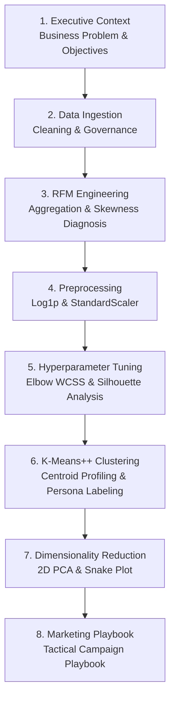

# Customer Segmentation: Notebook Walkthrough & Storytelling

This guide outlines the narrative architecture, cell layout, and data storytelling principles implemented in [`notebooks/Customer_Segmentation_RFM_Analytics.ipynb`](./Customer_Segmentation_RFM_Analytics.ipynb).

---

## 1. Storytelling Architecture

When presenting customer segmentation to business stakeholders, technical precision must be paired with strategic commercial impact. The notebook follows an 8-phase narrative arc:



---

## 2. Cell-by-Cell Blueprint

### Cell 1–2: Title, Domain & Environment Setup
- **Markdown**: Overview of the e-commerce business model, churn problems, and margin erosion caused by blanket promotional discounting.
- **Code**: Dependency imports (`pandas`, `numpy`, `sklearn`, `matplotlib`, `seaborn`) with deterministic random state seeds (`random_state=42`).

### Cell 3–4: Data Ingestion & Governance Filtering
- **Code**: Ingestion of [`data/online_retail_transactions.csv`](../data/online_retail_transactions.csv).
- **Transformation**:
  - Filter cancellations (`InvoiceNo` starting with `'C'`).
  - Drop missing `CustomerID` guest sessions.
  - Assert `Quantity > 0` and `UnitPrice > 0`.
  - Calculate `TotalPrice = Quantity * UnitPrice`.

### Cell 5–6: RFM Aggregation
- **Code**: Establish a reference snapshot date ($Max(\text{InvoiceDate}) + 1\text{ day}$) and aggregate transaction records by `CustomerID`:
  - $R$: Days elapsed since most recent transaction.
  - $F$: Count of unique order invoices.
  - $M$: Cumulative gross revenue spent.

### Cell 7–9: Handling Distribution Skewness & Standardization
- **Diagnosis**: Visual demonstration using KDE histograms showing extreme positive skewness in Frequency and Monetary values.
- **Normalization**: Application of natural log transformation $\log(x + 1)$ to reduce variance and achieve quasi-normal distributions.
- **Standardization**: `StandardScaler()` applied so all three dimensions have $\mu = 0$ and $\sigma = 1$, preventing high-spend values from dominating Euclidean distance calculations.

### Cell 10–11: Hyperparameter Optimization ($k$ Selection)
- **Evaluation**: Fitting K-Means models from $k = 2$ to $k = 8$.
- **Dual Evaluation Plot**:
  - Within-Cluster Sum of Squares (WCSS / Inertia) Elbow curve.
  - Silhouette Coefficient curve.
  - Selection of $k=4$ as the optimal trade-off between mathematical separability and business interpretability.

### Cell 12–13: Cluster Training & Dynamic Persona Assignment
- **Execution**: K-Means++ initialization with 10 restarts (`n_init=10`).
- **Dynamic Centroid Mapping**: Automated ranking assigns business-aligned personas:
  - **Champions (Super VIPs)**: Highest spend, highest frequency, shortest recency.
  - **Loyal Steady Buyers**: Consistent multi-order history, moderate recency.
  - **Recent / Potential Loyalists**: Short recency, initial orders, high growth potential.
  - **Dormant / At-Risk**: Long recency (inactivity > 6 months), low frequency.

### Cell 14–17: Analytical Visualizations & Export
- **Snake Plot**: Standardized RFM score lines comparing cluster strengths.
- **2D PCA Projection**: First two principal components accounting for **~86% of total variance**.
- **Pareto Revenue Bar Chart**: Visual verification of the Pareto principle (**16.5% of customers driving 64.9% of revenue**).
- **CSV Export**: Persisting [`output/segmented_customers.csv`](../output/segmented_customers.csv).

### Cell 18: Strategic Business Recommendations
- **Summary Table**: Actionable CRM, email remarketing, and VIP loyalty strategies tailored per customer cohort.

---

## 3. How to Launch Locally

```bash
# Activate your virtual environment and launch JupyterLab
jupyter lab notebooks/Customer_Segmentation_RFM_Analytics.ipynb
```
